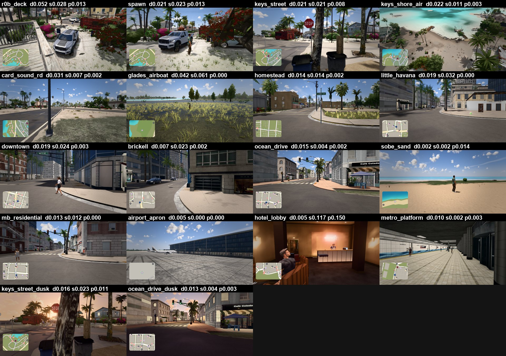

# r2-qa visual sweep (final)

2026-11-18T01:53:48.718Z. One boot, 18 cameras (12:30, two at dusk). Script: `node tools/v2/qa/visual.mjs` (analysis tools/v2/qa/visual_analyze.py). Contact sheet: docs/v2/shots/qa/visual_sheet.jpg. Per camera: docs/v2/shots/qa/visual/<id>.jpg and <id>_crop.jpg (2x crops of the worst dither, shimmer and splotch tiles). Raw: docs/v2/reports/qa-visual.json.

Automatic checks: (a) dither = share of 2x2 cells with checkerboard energy > 6; (b) splotch = saturation outliers (S > 0.75); (c) floating / sunk objects (raycast audit, 40 m around the view); (d) shimmer / z-fight = pixels changing > 14 between two still frames 10 frames apart (wind, water, people and cars also count); (e) missing textures = magenta pixels + materials whose texture never loaded (0 everywhere); (f) console. Then every frame was looked at by eye.

## Top 20 (ranked)

| # | sev | owner | problem | where / shot |
|---|---|---|---|---|
| 1 | high | r2-ground (readiness: r2-perf) | Player fell below the ground after a teleport, 4 times in one run (main.js anti-fall guard fired): Edgewater 359.4,-894.6; Ocean Dr 2431.1,395.1 (x2); Miami Beach 2296.1,-678.6. collidersReadyAt/readyAround timed out after 25-33 s at Edgewater and Downtown. | console; little_havana / ocean_drive / mb_residential |
| 2 | high | r2-render | Dotted look: foliage and shadow edges are stippled / screen-door dithered (alpha hash), worst at Nico's deck (2x2 checker energy 5.2 %, the highest of 18 cameras; bougainvillea, flamboyant canopy, shrub borders, the sand under the planter). | visual/r0b_deck_crop.jpg, r0b_deck.jpg, spawn.jpg |
| 3 | high | r2-art | Airport apron: two airliners parked inside each other (two tails side by side, fuselages merged) at the gate west of the terminal; the jet bridge does not reach either plane. | visual/airport_apron.jpg (eye -1300,6,1140 look -1380,8,1075) |
| 4 | high | r2-mapui | Minimap blank at the airport apron: plain grey card with only a few dots (no runway, apron or terminal drawn). | visual/airport_apron.jpg |
| 5 | high | r2-art / r2-people | Hotel lobby (South Beach hotel nearest 2398,660): Nico enters standing inside a faceted armchair, the chair back cuts through his torso and arm. | visual/hotel_lobby.jpg |
| 6 | high | r2-veg | Royal poinciana (flamboyant) by the spawn: the branches render as big flat dark triangular shards, not limbs. | visual/spawn.jpg (right half), r0b_deck.jpg |
| 7 | medium | r2-keys | Pelican Point Ln: a square wooden post sticks up out of the black trash can's lid (bin placed on a post / post through the bin). | visual/keys_street.jpg, keys_street_dusk.jpg (near -873,4825) |
| 8 | medium | r2-veg | Splotches: bougainvillea / hibiscus read as posterized magenta + green blobs (73 % saturation-outlier tile on the deck view); bushes at the spawn look smeared, painted. | visual/r0b_deck_crop.jpg (third crop), spawn.jpg |
| 9 | medium | r2-water | Glades (Big Cypress): the lake is bright Caribbean turquoise (fresh-water swamp should be dark tea); the marsh water is a flat grey sheet with the grass pushed through it; no airboat stand (gladeSites empty in a default boot), so the camera fell back to -4280,1040. | visual/glades_airboat.jpg |
| 10 | medium | r2-roads | Street furniture at the curb face instead of on the sidewalk: Sunset Dr name pole in the gutter (Homestead), NW 1st Ave signal pole on the curb (Downtown), SW 5th Ave signal pole merged into the building corner with the P sign (Brickell), Ocean Dr signal on the curb lip. | visual/homestead.jpg, downtown.jpg, brickell.jpg, ocean_drive.jpg |
| 11 | medium | r2-roads | Asphalt crack decals read as thin black scribbles / hairs across the lanes (Miami Beach 20th St, Ocean Dr). | visual/mb_residential.jpg, ocean_drive.jpg |
| 12 | medium | r2-roads / r2-art | Ocean Drive: the sidewalk is a flat saturated salmon color with no texture; both sides are buildings (no beach / Lummus Park side) and the facades are flat grey. | visual/ocean_drive.jpg, ocean_drive_dusk.jpg |
| 13 | medium | r2-veg / r2-people | South Beach sand: a bright green grass strip runs across the beach between the dry sand and the surf; one lone ball-shaped bush; no sunbathers because the sunbather spawn throws ([peds] spawn TypeError: Cannot read properties of null (reading 'add') at src/npc/peds.js:515, x5). | visual/sobe_sand.jpg |
| 14 | medium | r2-veg | Palm bark close-up is a low-res smeared zebra-stripe texture (Pelican Point Ln, also in daylight). | visual/keys_street_dusk.jpg, keys_street.jpg |
| 15 | medium | r2-look | Clouds: dozens of small identical cotton-ball puffs evenly sprinkled over the sky (cartoony, the same shape repeating), most visible on open views (South Beach, airport, Card Sound Rd). | visual/sobe_sand.jpg, airport_apron.jpg, card_sound_rd.jpg |
| 16 | medium | r2-art | Airport apron: hard grid of dark joint lines and the same pock-marked tile repeating to the horizon; terminal is a plain glass box. | visual/airport_apron.jpg |
| 17 | medium | r2-art | Edgewater NE 8th St: blank flat white wall with rusty door slabs and a dark roof plane slanting down over the sidewalk (reads broken). | visual/little_havana.jpg |
| 18 | low | r2-ground | Card Sound Rd median: the grass is a smeared low-res texture; the streetlight base is a crude box. | visual/card_sound_rd.jpg |
| 19 | low | r2-ground | Keys shore aerial: brown debris dots sprinkled evenly over the beach (reads as dots / dirt), flat grey oval sandbars in the water. | visual/keys_shore_air.jpg |
| 20 | low | r2-art | Hotel lobby: a dark grey box juts out of the front of the reception desk at knee height; the neon sign blooms to a pink blob. | visual/hotel_lobby.jpg |

## Per camera (worst 3 by eye + the automatic numbers)

| camera | district / road | worst 3 | automatic |
|---|---|---|---|
| r0b_deck | Key Largo /  | foliage and shadow edges dithered (dotted look); bougainvillea posterized magenta/green blobs; flamboyant branches as dark triangle shards | dither 0.052 / shimmer 0.0282 / splotch 0.0126 / magenta 0 / float 33 sink 26 / bad textures 0 |
| spawn | Key Largo /  | flamboyant branches as dark triangular shards; bushes smeared/painted; grass tufts sparse and repeating on bright sand | dither 0.0205 / shimmer 0.023 / splotch 0.0131 / magenta 0 / float 30 sink 21 / bad textures 0 |
| keys_street | Key Largo / Pelican Point Ln | wooden post through the trash can lid; palm bark low-res; bins right at the camera (sidewalk crowded with bins and trunk) | dither 0.0208 / shimmer 0.0213 / splotch 0.0076 / magenta 0 / float 30 sink 27 / bad textures 0 |
| keys_shore_air | Key Largo /  | brown debris dots over the beach; flat grey oval sandbars; dock end in the water unattached | dither 0.0222 / shimmer 0.0114 / splotch 0.0028 / magenta 0 / float 14 sink 3 / bad textures 0 |
| card_sound_rd | Key Largo / Card Sound Road | median grass smeared texture; light pole base crude box; cotton-ball clouds | dither 0.031 / shimmer 0.0069 / splotch 0.0016 / magenta 0 / float 15 sink 6 / bad textures 0 |
| glades_airboat | Big Cypress /  | turquoise lake in the Everglades; flat grey marsh water sheet; no airboat stand found; cone-shaped low-poly pines | dither 0.0417 / shimmer 0.0615 / splotch 0.0 / magenta 0 / float 8 sink 0 / bad textures 0 |
| homestead | Homestead / Royal Palm Way | Sunset Dr name pole in the gutter; plaza tufts read as yellow noise; flat boxy buildings | dither 0.0138 / shimmer 0.0141 / splotch 0.002 / magenta 0 / float 10 sink 6 / bad textures 0 |
| little_havana | Edgewater / NE 8th St | slanted dark roof plane over the sidewalk; flat white wall with rusty door slabs; very wide empty asphalt (camera landed on NE 8th St, Edgewater, not Calle Ocho) | dither 0.0192 / shimmer 0.0315 / splotch 0.0 / magenta 0 / float 19 sink 6 / bad textures 0 |
| downtown | Downtown / State Road 1042 | signal pole on the curb face; storefront interiors flat white; thin straight dark line across the sidewalk (signal arm shadow, OK) | dither 0.0193 / shimmer 0.0244 / splotch 0.003 / magenta 0 / float 21 sink 8 / bad textures 0 |
| brickell | Brickell / SW 17th St | signal pole merged into the building corner + P sign; white tire-smoke blob by the pickup; garage door flat | dither 0.0066 / shimmer 0.0231 / splotch 0.002 / magenta 0 / float 8 sink 3 / bad textures 0 |
| ocean_drive | South Beach / Ocean Dr | flat salmon sidewalk; no beach side; crack decals as scribbles | dither 0.0154 / shimmer 0.0045 / splotch 0.0018 / magenta 0 / float 15 sink 13 / bad textures 0 |
| sobe_sand | South Beach /  | green grass strip across the beach; lone ball bush; no beach life (sunbather spawn error) | dither 0.0015 / shimmer 0.0022 / splotch 0.0143 / magenta 0 / float 1 sink 1 / bad textures 0 |
| mb_residential | Miami Beach / 20th St | crack decals as black scribbles; not residential (commercial street found); palm planted at the curb lip | dither 0.0135 / shimmer 0.0118 / splotch 0.0002 / magenta 0 / float 11 sink 9 / bad textures 0 |
| airport_apron | Miami International Airport /  | two airliners inside each other; minimap blank; apron tiling grid | dither 0.0053 / shimmer 0.0003 / splotch 0.0 / magenta 0 / float 0 sink 0 / bad textures 0 |
| hotel_lobby | South Beach /  | Nico inside the armchair; box jutting from the desk; neon sign blown out | dither 0.0047 / shimmer 0.1173 / splotch 0.1501 / magenta 0 / float - sink - / bad textures 0 |
| metro_platform | Miami International Airport /  | floor tiling repetitive; ceiling flat and dark; platform doors read as black slabs | dither 0.0096 / shimmer 0.0015 / splotch 0.0025 / magenta 0 / float - sink - / bad textures 0 |
| keys_street_dusk | Key Largo / Pelican Point Ln | palm bark zebra texture; post through the trash can; dumpster glows red | dither 0.0156 / shimmer 0.0229 / splotch 0.0114 / magenta 0 / float 26 sink 26 / bad textures 0 |
| ocean_drive_dusk | South Beach / Ocean Dr | grass strip spills onto the road edge; facades unlit flat; cafe chair at the curb lip | dither 0.0133 / shimmer 0.0035 / splotch 0.0026 / magenta 0 / float 15 sink 13 / bad textures 0 |

## Notes

- No missing textures (0 magenta pixels, 0 materials with an unloaded map) and 0 console errors; warnings: player fell below ground x4, the sunbather spawn TypeError x5 (src/npc/peds.js:515), [ragdoll] unstable, frozen x2 (src/npc/ragdoll.js:545), nicoHouse atlas overflow.
- Shimmer is highest in the hotel lobby (11.7 %: the idle player and the receptionist animate, not flicker) and the glades (6.2 %: grass in the wind). No z-fight band was found in the still-frame diff on static surfaces.
- The float audit keeps flagging 'miami-city' street props at a constant +1.94 m (sign plates such as reg-stop on posts the ray slips past) and -1.35 / -1.69 / -1.88 m (1.1 m tall items) in every district; that constant offset looks like pooled / hidden instances or plates on thin posts, so it is listed for r2-ground to check rather than ranked.
- Nico's yard: the AC fins (1.63 m) and towels (1.3-1.5 m) are on purpose (r2-keys).
